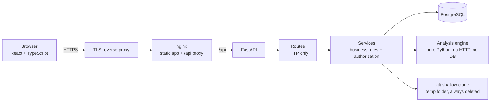
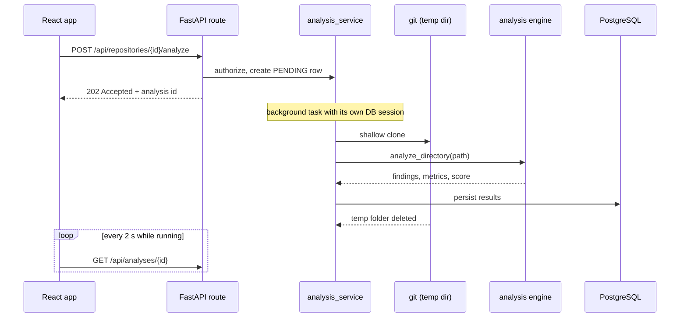
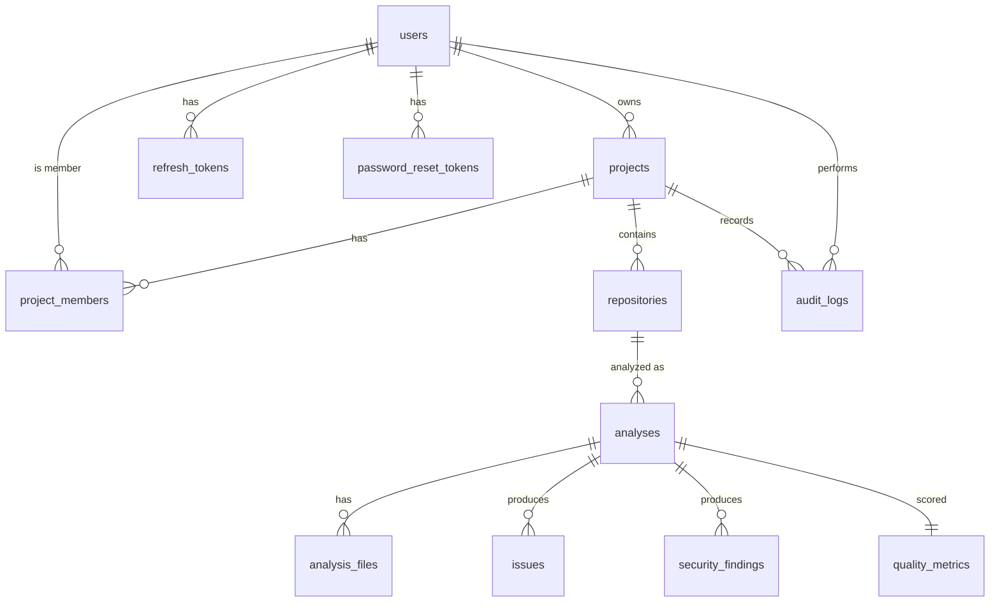

# CodeScope

**Understand your codebase. Improve your engineering.**

CodeScope is a developer-intelligence platform. Point it at a public GitHub repository and it reports code quality, complexity, maintainability and (static) security findings, keeps every analysis so you can watch scores improve, and lets a team triage the findings together.

## Quick start (no setup needed)

You only need **Docker** (Docker Desktop on Windows/macOS).

| System | Start | Stop |
|---|---|---|
| Windows | double-click **`start.bat`** | double-click `stop.bat` |
| Linux / macOS | `./start.sh` | `./stop.sh` |
| Any | `docker compose up --build -d` | `docker compose down` |

Then open **http://localhost:8080**, register an account, create a project, add a public GitHub repository and run an analysis.

The first start builds the images and takes a few minutes. Everything has a working local default, so there is nothing to configure. To change ports or secrets, edit `.env`.

Want the frontend on **Vercel** and the backend on **Render**? Follow **[DEPLOY-VERCEL-RENDER.md](DEPLOY-VERCEL-RENDER.md)**.

Something went wrong? See [Troubleshooting](#troubleshooting).

## Table of contents

1. [Problem](#problem)
2. [Features](#features)
3. [Architecture](#architecture)
4. [Tech stack](#tech-stack)
5. [Database schema](#database-schema)
6. [Authentication](#authentication)
7. [Authorization](#authorization)
8. [Analysis pipeline](#analysis-pipeline)
9. [AI/ML layer](#aiml-layer)
10. [API documentation](#api-documentation)
11. [Screenshots](#screenshots)
12. [Development setup](#development-setup)
13. [Testing](#testing)
14. [Environment variables](#environment-variables)
15. [Deployment](#deployment)
16. [Troubleshooting](#troubleshooting)
17. [Limitations](#limitations)
18. [Future improvements](#future-improvements)

## Problem

Code quality problems build up quietly: functions grow, nesting deepens, secrets slip into commits. Teams usually notice only when something breaks. Existing tools tend to be either heavyweight platforms or one-off linters with no history and no workflow.

CodeScope focuses on three things:

- **Explainable results.** Every finding comes from a deterministic rule with a fixed severity. Scores come from a documented formula.
- **Progress over time.** Every analysis is stored, so "did we improve?" has a chart as its answer.
- **Team workflow.** Roles, issue triage (resolve / ignore) and an audit log.

## Features

- Email + password accounts with short-lived access tokens and rotating refresh tokens
- Password reset flow (development-safe token delivery, see [Authentication](#authentication))
- Projects with four roles: OWNER, ADMIN, MEMBER, VIEWER
- Add public GitHub repositories (validated, normalized, de-duplicated)
- Analysis of **Python** (real AST), **JavaScript** and **TypeScript** (heuristic parser)
- Quality rules, complexity metrics, duplicate detection, unused imports
- Static security checks (secrets, `eval`/`exec`, shell and SQL injection patterns, weak hashing, and more)
- Transparent 0-100 scores: overall, code quality, maintainability, complexity, security
- Report page: overview, quality, complexity, security, architecture, files, issues, AI insights, history
- Issue lifecycle: OPEN / RESOLVED / IGNORED, with who and when. Ignored issues stay ignored on re-analysis
- Live analysis progress, dashboard with trends, per-project activity feed (audit log)
- Responsive UI, keyboard-accessible dialogs and tabs, skeleton loading, empty states, toasts

## Architecture



**Layering rule.** Routes handle HTTP only. Services hold business logic and authorization. The analysis engine (`backend/app/analysis/`) knows nothing about FastAPI, SQLAlchemy or HTTP: source text goes in, structured results come out. That is why it is unit-tested without a database.



### Repository layout

```
backend/app/
├── api/            routes + dependencies (auth, project permissions)
├── core/           config, database, security, permissions, errors
├── models/         SQLAlchemy 2.x models
├── schemas/        Pydantic v2 request/response models
├── services/       business logic (auth, projects, repositories, analysis, issues, reports, dashboard)
├── ingestion/      GitHub URL validation + safe git cloning
├── intelligence/   summaries and clustering (pure functions)
└── analysis/       the analysis engine (analyzers, parsers, quality, security, complexity, metrics)
frontend/src/
├── auth/  lib/  components/  pages/
```

## Tech stack

| Layer | Technology |
|---|---|
| Frontend | React 18, TypeScript, Vite, Tailwind CSS, React Router, TanStack Query, Recharts, Lucide icons |
| Backend | Python 3.12, FastAPI, Pydantic v2, SQLAlchemy 2.x, Alembic |
| Database | PostgreSQL 16 |
| Auth | JWT (PyJWT), Argon2 password hashing |
| Tests | pytest (backend), Vitest + React Testing Library (frontend) |
| Infrastructure | Docker, Docker Compose, nginx, Caddy, GitHub Actions; optional Vercel + Render deployment |

## Database schema



| Table | Purpose |
|---|---|
| `users` | Accounts. `password_hash` only, never the password |
| `projects`, `project_members` | Projects and per-project roles. Unique `(project_id, user_id)` |
| `repositories` | Public GitHub repos in a project. Unique `(project_id, url)` |
| `analyses` | One row per run: status, progress, branch, commit, summary numbers, AI summary |
| `analysis_files` | Per-file metrics for one analysis |
| `issues` | Quality findings with `status`, `resolved_by`, `resolved_at`. Never deleted |
| `security_findings` | Static security findings |
| `quality_metrics` | The five scores plus counts for one analysis |
| `refresh_tokens` | Hashed, rotating refresh tokens |
| `password_reset_tokens` | Hashed, single-use reset tokens |
| `audit_logs` | Who did what, in which project |

Foreign keys, indexes, unique constraints and timestamps are defined in `backend/app/models/models.py`. Schema changes go through Alembic migrations in `backend/alembic/versions/`. The initial migration (`0001_initial_schema.py`) is included.

## Authentication

- **Passwords** are hashed with Argon2. Login returns the same error for an unknown email and a wrong password (no account enumeration).
- **Access token**: a 15-minute JWT, kept in memory by the frontend. Tokens of the wrong type, expired, or signed with another key (including `alg: none`) are rejected.
- **Refresh token**: a random opaque string. Only its SHA-256 hash is stored. It is **single-use and rotated** on every refresh. Logout revokes it.
- **Frontend**: one shared in-flight refresh, so concurrent requests cannot race and burn the single-use token. The session is restored on page load.
- **Password reset**: tokens are hashed, single-use, expire after 30 minutes, and requesting a new link invalidates older ones. A successful reset signs the user out everywhere. There is no email provider yet: with `APP_ENV=development` the token is returned to the UI; in production it is never exposed (a marked `TODO` in `routes/auth.py` is where email sending belongs).
- The API refuses to start in production with a weak or placeholder `JWT_SECRET`.

## Authorization

Authorization is enforced **on the server for every endpoint**. The frontend hides buttons only for convenience.

| Permission | OWNER | ADMIN | MEMBER | VIEWER |
|---|:-:|:-:|:-:|:-:|
| View reports, issues, activity | ✓ | ✓ | ✓ | ✓ |
| Run analyses, triage issues | ✓ | ✓ | ✓ | |
| Edit project, add repositories | ✓ | ✓ | | |
| Invite and remove members | ✓ | ✓ | | |
| Create admins, change roles, delete project | ✓ | | | |

Design rules:

- **Object-level checks.** Every project-scoped route resolves the project **through the caller's membership**. Changing an id in the URL never exposes another team's data. Child resources (repository, analysis, issue, member) are traced back to their project and checked the same way.
- **404 vs 403.** A non-member gets **404**, so project ids cannot be probed. A member without the permission gets **403**.
- The owner cannot be removed, demoted or duplicated. Admins cannot create or remove other admins.
- The permission matrix is a single dictionary (`core/permissions.py`) and is tested as a table.

## Analysis pipeline

1. **Validate** the URL (https, `github.com` only, no credentials or ports, safe characters) and the branch name (cannot start with `-`).
2. **Check** the repository exists with `git ls-remote` (no code downloaded). Detects the default branch.
3. **Clone** with `git clone --depth 1` into a temp folder: https only, symlinks disabled, hooks disabled, prompts disabled, minimal environment, timeout, size cap. The folder is **deleted** when the run ends, on success or failure.
4. **Discover** files: skips dependency and build folders, hidden folders, symlinks, oversized files, and caps the file count.
5. **Analyze** each file: Python through the standard `ast` module; JavaScript and TypeScript through a heuristic parser (comments and strings are blanked, functions and complexity are measured structurally).
6. **Score**, **summarize**, **persist**. One unparseable file becomes a warning, not a failed run.

### Rules

| Rule | Detects | Default threshold |
|---|---|---|
| QUAL-001 | Long function | > 50 lines |
| QUAL-002 | Too many parameters | > 5 |
| QUAL-003 | Deep nesting | > 4 |
| QUAL-004 | Too many branches | > 10 |
| QUAL-005 | High cyclomatic complexity | > 15 |
| QUAL-006 | Large file | > 500 lines |
| QUAL-007 | Unused import | module-level, conservative |
| QUAL-008 | Duplicate function body | identical body, ≥ 6 statements |
| QUAL-009 to 011 | Vague or non-conventional names | |
| SEC-* | Secrets and known token formats, `eval`/`exec`, shell and SQL injection patterns, weak password hashing, unsafe deserialization, TLS verification off, DOM XSS sinks | |

Thresholds live in `backend/app/analysis/config.py`.

**Severity is deterministic.** Threshold rules use one ratio scale: up to 1.5× the threshold is LOW, up to 2.5× is MEDIUM, above that is HIGH. CRITICAL is reserved for security findings such as leaked token formats.

### Scoring

Each finding costs points: LOW 1, MEDIUM 3, HIGH 6, CRITICAL 12. Penalties are scaled **per 1,000 lines of code** so large repositories are not punished for size.

| Dimension | Formula |
|---|---|
| Code quality | 100 − 3 × (naming, unused-code and duplication points) / KLOC |
| Maintainability | 100 − 3 × (maintainability points) / KLOC |
| Complexity | 100 − 3 × (complexity points) / KLOC − min(30, max(0, avg. cyclomatic − 5) × 4) |
| Security | 100 − 4 × (security points) / KLOC, capped at 60 if any CRITICAL finding exists |
| Overall | average of the four |

This is a transparent heuristic, **not a scientific measure**. The report page explains it to users.

## AI/ML layer

The deterministic analyzer is the source of truth. The intelligence layer sits on top and is clearly labelled in the UI.

- **Summary**: a templated, rule-based paragraph generated from the structured results (strongest and weakest dimension, severity counts, hot-spot file, trend versus the previous run). It is not a language model.
- **Recommendations**: an ordered, deterministic list of next steps (critical security first).
- **Grouping**: local **TF-IDF + cosine similarity** (pure Python) clusters similar findings by their *descriptions only*.
- **Privacy**: no source code is ever sent to an external service, and no paid LLM is used.

## API documentation

All routes are under `/api` and return errors in one shape: `{"error": {"code", "message", "details?"}}`. With `APP_ENV=development`, interactive docs are at `http://localhost:8000/docs`.

| Area | Endpoint | Minimum role |
|---|---|---|
| Auth | `POST /auth/register`, `/auth/login`, `/auth/refresh`, `/auth/logout` | public |
| | `GET /auth/me` | signed in |
| | `POST /auth/forgot-password`, `/auth/reset-password` | public |
| Projects | `POST /projects`, `GET /projects` | signed in |
| | `GET /projects/{id}` | VIEWER |
| | `PATCH /projects/{id}` | ADMIN |
| | `DELETE /projects/{id}` | OWNER |
| Members | `GET /projects/{id}/members` | VIEWER |
| | `POST /projects/{id}/members`, `DELETE /projects/{id}/members/{member_id}` | ADMIN |
| | `PATCH /projects/{id}/members/{member_id}` | OWNER |
| Repositories | `GET /projects/{id}/repositories` | VIEWER |
| | `POST /projects/{id}/repositories` | ADMIN |
| | `POST /repositories/{id}/analyze` | MEMBER |
| | `GET /repositories/{id}/history` | VIEWER |
| Analyses | `GET /analyses/{id}` (also used for polling) | VIEWER |
| | `GET /analyses/{id}/report`, `/insights`, `/files`, `/issues`, `/security` | VIEWER |
| Project views | `GET /projects/{id}/analyses`, `/issues`, `/activity` | VIEWER |
| Issues | `GET /issues/{id}` | VIEWER |
| | `PATCH /issues/{id}/status` | MEMBER |
| Dashboard | `GET /dashboard`, `GET /activity` | signed in |
| Meta | `GET /health` (not under `/api`) | public |

Status codes: `202` for started analyses, `401` unauthenticated, `403` role too low, `404` missing or not yours, `409` conflict (duplicate repository, analysis already running, report not ready), `422` validation, `502` GitHub unreachable.

## Screenshots

Add your own screenshots to `docs/screenshots/` and link them here:

```markdown


```

## Development setup

For editing code with live reload (backend in Docker, frontend with Vite):

```bash
docker compose -f docker-compose.yml -f docker-compose.dev.yml up --build   # database + API with reload
cd frontend
npm install
npm run dev                                                                  # http://localhost:5173
```

The dev file publishes the API on `127.0.0.1:8000` (interactive docs at `/docs`) and the database on `127.0.0.1:5433` (not 5432, so it does not clash with a PostgreSQL you may already run). Change `BACKEND_HOST_PORT` / `POSTGRES_HOST_PORT` in `.env` if those are taken too.

Migrations are applied automatically when the backend starts. To create one after changing a model:

```bash
docker compose -f docker-compose.yml -f docker-compose.dev.yml run --rm --no-deps backend alembic revision --autogenerate -m "describe the change"
```

## Testing

```bash
# backend: needs the database container. A separate <db>_test database is created automatically
docker compose up -d postgres
docker compose run --rm --no-deps backend pytest

# frontend
cd frontend && npm install && npm test
```

- **Backend** (265 tests): unit tests for the pure engine (AST, quality rules, security rules, scoring, URL parsing, clustering), and integration tests against a real PostgreSQL through the HTTP API: authentication, password reset, the full role × endpoint authorization matrix (including 404-vs-403 and cross-project id tampering), repository validation, the end-to-end analysis flow, the issue lifecycle, and the dashboard. Only `git` is faked. The suite refuses to run against a database whose name does not end in `_test`.
- **Frontend** (71 tests): token refresh (including the single-flight guarantee), session restore, route guards, forms, dialog accessibility (focus trap, Escape, focus restore) and the issue drawer.
- **CI** (`.github/workflows/ci.yml`): backend tests on a Postgres service, frontend tests and build, and a Docker smoke test of the full stack.

## Environment variables

Every variable has a working default (see `docker-compose.yml`), so `.env` is optional locally. `./deploy.sh` writes a production `.env` for you.

| Variable | Default | Description |
|---|---|---|
| `APP_ENV` | `development` | `development` enables API docs and the dev-only reset token. `production` enforces a strong secret, hides docs and never exposes reset tokens |
| `POSTGRES_USER`, `POSTGRES_PASSWORD`, `POSTGRES_DB` | `codescope`, dev password, `codescope` | Database credentials. The backend's `DATABASE_URL` is built from them automatically |
| `JWT_SECRET` | dev placeholder | At least 32 random characters in production. The API refuses to start otherwise |
| `JWT_ACCESS_EXPIRE_MINUTES` | `15` | Access token lifetime |
| `JWT_REFRESH_EXPIRE_DAYS` | `7` | Refresh token lifetime |
| `APP_BIND` | `127.0.0.1` | Interface the web app listens on. `0.0.0.0` exposes it to the network |
| `APP_PORT` | `8080` | Port of the web app |
| `DOMAIN` | empty | Set (by `deploy.sh`) to enable automatic HTTPS with Caddy |
| `CORS_ORIGINS` | `http://localhost:5173` | Only needed if the frontend is served from another origin |
| `POSTGRES_HOST_PORT`, `BACKEND_HOST_PORT` | `5433`, `8000` | Development-only published ports (`docker-compose.dev.yml`) |
| `DATABASE_URL` | built from the `POSTGRES_*` values | Only set directly on hosts without Docker Compose (Render). `postgres://` and `postgresql://` URLs are accepted and converted for the psycopg 3 driver |
| `PORT` | `8000` | Port the API listens on. Hosts such as Render set it themselves |
| `CORS_ORIGIN_REGEX` | empty | Extra allowed web origins as a regex, e.g. Vercel previews: `https://myapp(-[a-z0-9-]+)?\.vercel\.app` |
| `AUTH_RATE_LIMIT_PER_MINUTE` | `30` | Sign-in throttling per IP (a third of it per account). `0` turns it off |
| `MAX_REPO_MB` | `300` | Largest repository the analyzer accepts. Use `100` on small hosting plans |
| `VITE_API_URL` | unset | **Frontend build** setting for Vercel: the API's address. Unset keeps same-origin `/api` |
| `TEST_DATABASE_URL` | derived | Optional override for the test database (name must end in `_test`) |

## Deployment

CodeScope runs on a single Linux server with Docker. Two commands:

```bash
# 1) copy the project to the server and cd into it, then:
./deploy.sh codescope.example.com     # HTTPS with an automatic certificate
# or, without a domain (plain HTTP on port 8080, only for a private network):
./deploy.sh
```

`deploy.sh`:

- creates a **production `.env`** with freshly generated random secrets (only if one does not exist, so re-running is safe and keeps your data),
- with a domain: starts **Caddy**, which obtains and renews a free HTTPS certificate (the domain's DNS must already point at the server, and ports 80 and 443 must be open),
- builds and starts everything and waits until all services are healthy.

**Updating:** copy the new files over, then run `./deploy.sh` again. Migrations run on start.

**Backups** (schedule this with cron and copy the files off the server; test a restore):

```bash
docker compose exec -T postgres pg_dump -U codescope codescope | gzip > backup-$(date +%F).sql.gz
```

### Alternative: frontend on Vercel, backend on Render

Two separate deployments: the React app as a static site on Vercel, the API and its database on Render. The repository includes `render.yaml` (a Render Blueprint) and `frontend/vercel.json`. The step-by-step guide is **[DEPLOY-VERCEL-RENDER.md](DEPLOY-VERCEL-RENDER.md)**. In short:

1. Push the project to GitHub.
2. Render: **New → Blueprint** → pick the repository (creates the API and the database).
3. Vercel: import the repository, set **Root Directory** to `frontend`, add `VITE_API_URL` = the Render address.
4. Render: set `CORS_ORIGINS` to your Vercel address.

The free tiers are for trying things out: the free Render database is deleted after 30 days and the free API sleeps when idle. The guide lists what to upgrade for real use.

### Production checklist

- [ ] `./deploy.sh` created `.env` with `APP_ENV=production` (keep that file private and back it up)
- [ ] HTTPS is on (pass a domain to `deploy.sh`) and only ports 80/443 are open on the firewall
- [ ] The database is **not** published: nothing outside Docker can reach it
- [ ] Backups are scheduled and a restore has been tested
- [ ] **One backend process**: do not scale the `backend` service (see Limitations)
- [ ] An email provider is connected for password reset (reset tokens are not delivered otherwise)
- [ ] Docker log rotation is configured and `/health` is monitored

## Troubleshooting

| Symptom | Fix |
|---|---|
| `port is already allocated` / `address already in use` | Another program uses the port. Edit `.env` and change `APP_PORT` (for example `8081`), then start again. For the dev ports change `POSTGRES_HOST_PORT` / `BACKEND_HOST_PORT` |
| `password authentication failed` in the backend log | An old database volume with a different password exists. If you have no data to keep: `docker compose down -v` then start again |
| The page loads but shows "Cannot reach the CodeScope server" | The backend is still starting or crashed. `docker compose logs backend` |
| Backend exits with `JWT_SECRET must be a random string...` | You set `APP_ENV=production` with the placeholder secret. Run `./deploy.sh`, or put a random 32+ character `JWT_SECRET` in `.env` |
| `Docker is not running` | Start Docker Desktop and wait until it reports it is running |
| First start takes very long | It is building the images (downloads base images and packages). Later starts take seconds |
| Analysis fails with "Repository not found" | Only **public** `github.com` repositories are supported |

To see what is happening: `docker compose ps` (health of each service) and `docker compose logs -f`.

## Limitations

- **JavaScript and TypeScript are analyzed heuristically**, not with a real parser. Unusual syntax can be missed or measured slightly off. Python uses the real AST.
- **Security results are static checks**, not a security audit. A clean result does not mean the code is secure.
- **Scores are a transparent heuristic**, not a scientific measure.
- **Background jobs are in-process.** A restart interrupts running analyses; they are marked failed on startup rather than left spinning. This also means the API must run as a single process.
- **Public GitHub repositories only.**
- The refresh token is stored in `localStorage`, readable by any XSS. An HttpOnly cookie would be stronger.
- No email delivery. Sign-in is rate limited by the app per IP and per account (in memory, per process, so counters reset on restart), and by nginx in the Docker setup. There is no permanent lockout and no 2FA.
- The top-bar search and notifications are interface placeholders with no backend yet.

## Future improvements

- A durable job queue and worker (analyses survive restarts, horizontal scaling)
- HttpOnly cookie sessions, email verification and delivery, per-account lockout, 2FA
- Real parsers (tree-sitter) for JavaScript and TypeScript, and more languages
- Private repositories through a GitHub App; webhooks and pull-request comments
- Per-project thresholds and rule configuration; a partial unique index to guarantee one active analysis per repository
- Server-sent events instead of polling; notifications; search
- Playwright end-to-end tests; a coverage gate
