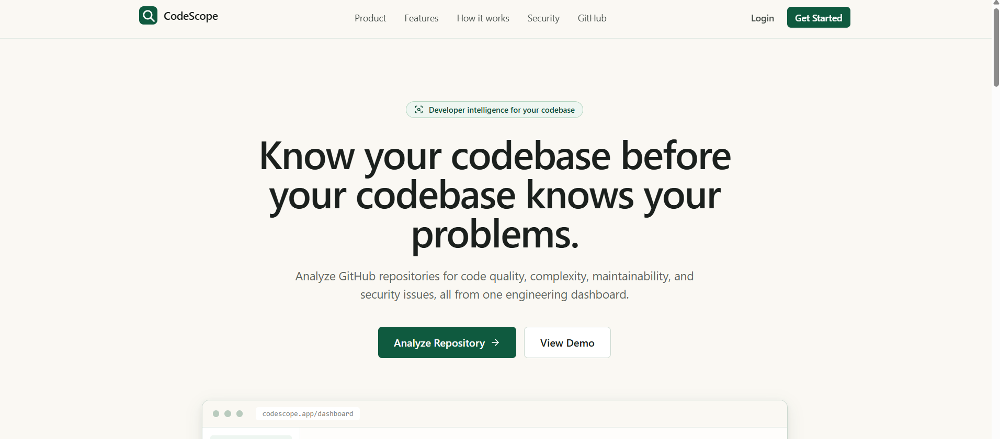
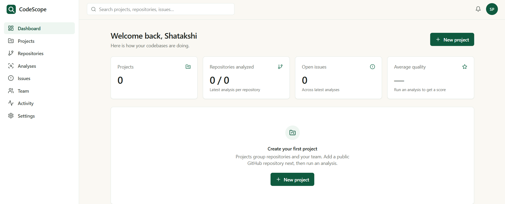
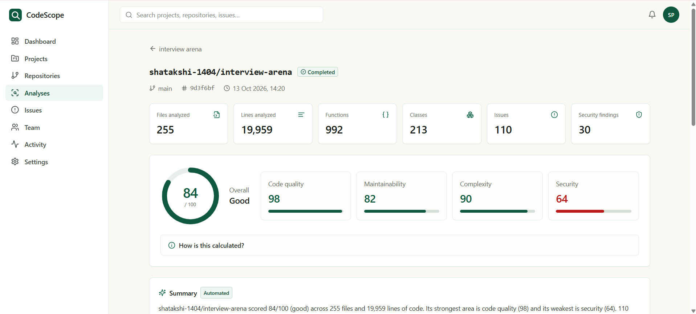
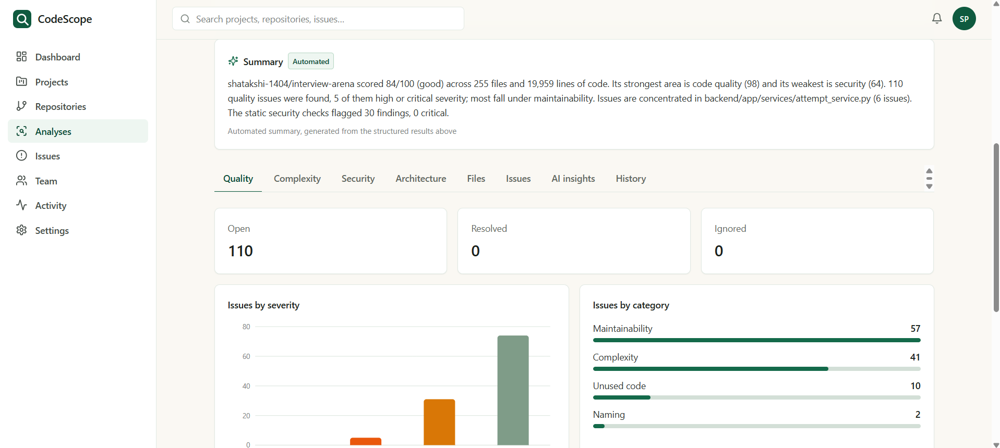
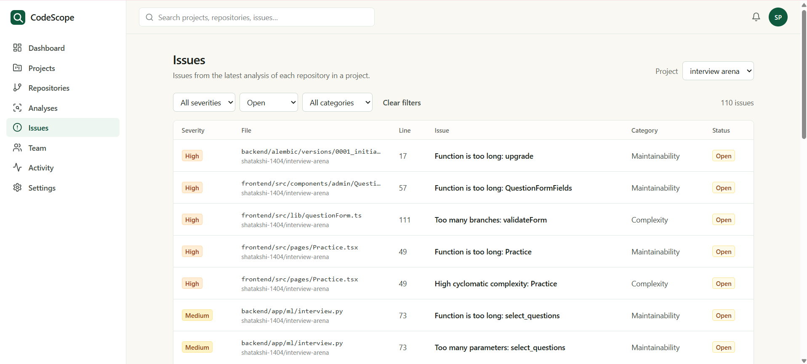
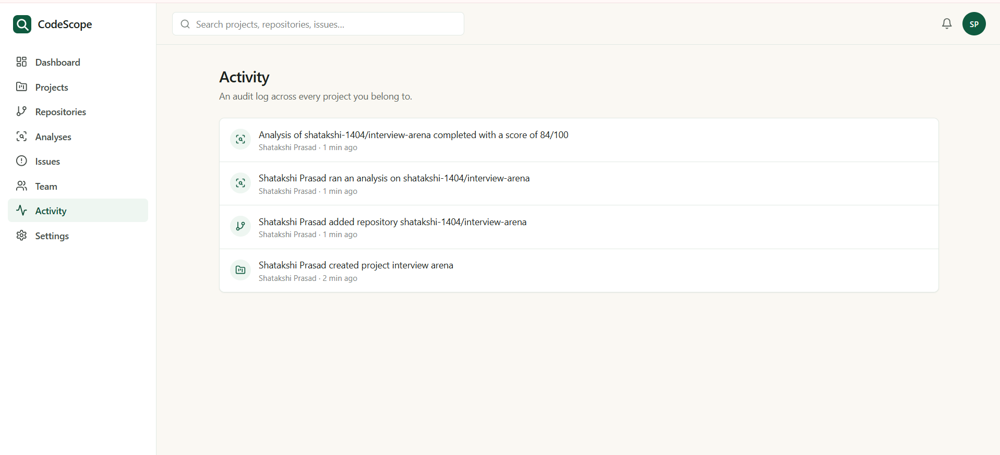

# CodeScope — Codebase Health & Analysis Platform

**Understand your codebase. Detect issues. Improve code quality.**

CodeScope is a developer-focused platform designed to analyze codebases, identify potential code-quality and security issues, track code health, and help developers prioritize improvements.

<p align="center">
  <a href="https://codescope.vercel.app/">
    
  </a>
  
</p>

<p align="center">
  <b>React · TypeScript · FastAPI · PostgreSQL · Python · Docker</b>
</p>

---

## 📌 Overview

CodeScope aims to make codebase analysis easier by bringing code-quality insights, potential security issues, health metrics, and issue prioritization into a single developer-friendly interface.

The project focuses on making code analysis more actionable, helping developers understand where problems exist and which improvements deserve attention first.

The application has been deployed, with continued work on integrations, testing, and production readiness.

## 🌐 Live Demo

**Explore CodeScope:** https://codescope.vercel.app/

---

## 📸 Application Screenshots

The following sections are ready for screenshots of your actual application pages.

To display them, add your images to the `screenshots/` directory in the repository root and use the filenames shown below.

### 1. Landing Page

An overview of CodeScope and its purpose.

<p align="center">
  
</p>

### 2. Main Dashboard

A central view of codebase health, analysis summaries, and key metrics.

<p align="center">
  
</p>

### 3. Repository Analysis

The interface for selecting or submitting a codebase for analysis.

<p align="center">
  
</p>

### 4. Code Quality and Health Metrics

A view of code-quality indicators and potential maintainability concerns.

<p align="center">
  
</p>

### 5. Security Findings

A view of potential security issues and their severity, where supported by the implemented analyzer.

<p align="center">
  
</p>

### 6. Issue Triage

Review, categorize, and prioritize findings to make remediation more manageable.

<p align="center">
  
</p>

### 7. Analysis History

A view of previous analyses and historical code-health information, where available.

<p align="center">
  
</p>

### 8. Detailed Finding View

Inspect an individual finding and the associated explanation or remediation guidance.

<p align="center">
  
</p>

---

## ✨ Key Features

### Codebase Analysis
- Analyze supported source code for potential quality issues.
- Identify patterns that may indicate maintainability concerns.
- Generate code-health information to help developers understand their codebase.

### Security Analysis
- Detect supported patterns that may indicate potential security risks.
- Organize findings by severity where implemented.
- Help developers review and prioritize issues.

### Issue Management
- Review and triage analysis findings.
- Organize issues for follow-up and remediation.
- Maintain historical analysis information where persistence is configured.

### Developer Experience
- A dashboard-oriented interface for reviewing findings.
- Structured analysis results.
- A workflow designed to make code-quality improvements easier to track.

### Local-First Analysis Approach

CodeScope is designed around analyzing code without requiring developers to upload source files to an external LLM service. Document the exact analysis and data-handling behavior supported by the current implementation.

---

## 🛠️ Technology Stack

| Component | Technology |
|---|---|
| Frontend | React, TypeScript, Vite |
| Backend | Python, FastAPI |
| API validation | Pydantic |
| Database | PostgreSQL |
| ORM | SQLAlchemy |
| Database migrations | Alembic |
| Authentication | JWT and Argon2 |
| Code analysis | Python AST and JavaScript/TypeScript heuristics |
| Similarity analysis | TF-IDF and cosine similarity |
| Containerization | Docker |
| Deployment | Vercel and configured backend hosting |

---

## 🏗️ System Architecture

```text
                Developer
                    |
                    v
           React + TypeScript UI
                    |
                 REST API
                    |
                    v
              FastAPI Backend
                    |
          +---------+----------+
          |         |          |
          v         v          v
       Analysis   Auth &     History /
       Services   Access     Audit Logs
          |         |          |
          +---------+----------+
                    |
                    v
             SQLAlchemy ORM
                    |
                    v
               PostgreSQL

       Analysis Pipeline
                    |
                    v
        Parse → Analyze → Score
                    |
                    v
         Findings → Triage → History
```

The frontend presents analysis results and supports user interaction. The backend handles API requests, validation, authorization, analysis workflows, and persistence. The analysis pipeline uses language-specific techniques to identify supported patterns and produce structured findings.

---

## 🔐 Security and Privacy

CodeScope is designed with security and responsible code handling in mind.

- Authentication and role-based access control are part of the application design.
- Repository validation and controlled analysis workflows help reduce unsafe input handling.
- Temporary analysis files should be cleaned up after processing.
- Database credentials and secret keys must remain in environment variables or deployment secrets.
- Analysis results should be accessible only to authorized users.

Static analysis and heuristic checks cannot guarantee that a codebase is free of vulnerabilities. Findings require appropriate review and validation.

---

## 🚧 Development Status

| Area | Status |
|---|---|
| Frontend deployment | Deployed |
| FastAPI backend | Implemented; deployed connectivity should be verified |
| Code analysis pipeline | Implemented for supported analysis rules |
| Authentication and authorization | Implemented; end-to-end validation ongoing |
| Database persistence | Requires deployment verification |
| Code-quality scoring | Implemented for supported metrics |
| Finding triage and history | Verify current deployed functionality |
| Testing and production hardening | Ongoing |

## 🗺️ Roadmap

- [ ] Verify the complete deployed analysis workflow.
- [ ] Test authentication and role-based authorization.
- [ ] Validate database persistence and analysis history.
- [ ] Expand language support and analysis rules.
- [ ] Improve finding explanations and remediation guidance.
- [ ] Strengthen input validation and error handling.
- [ ] Add more unit, integration, and end-to-end tests.
- [ ] Improve deployment observability and operational reliability.
- [ ] Add more detailed architecture documentation and demonstration screenshots.

---

## 💻 Local Development

### Prerequisites

- Python compatible with the backend dependencies.
- Node.js and npm.
- PostgreSQL 16.
- Git.
- Docker.

### 1. Clone the repository

```bash
git clone <YOUR_CODESCOPE_GITHUB_REPOSITORY_URL>
cd CodeScope
```

Replace the placeholder with the actual GitHub repository URL.

### 2. Configure the backend

Navigate to the backend directory, create a virtual environment, install the project's dependencies, and configure the required environment variables.

```bash
python -m venv .venv
```

On Windows PowerShell:

```powershell
.venv\Scripts\Activate.ps1
```

Install dependencies using the backend's actual dependency file:

```bash
pip install -r requirements.txt
```

Configure the PostgreSQL connection and apply database migrations if Alembic is configured:

```bash
alembic upgrade head
```

Start the API using the application's actual entry point. For example:

```bash
uvicorn main:app --reload
```

### 3. Configure the frontend

Navigate to the frontend directory and install its dependencies:

```bash
npm install
npm run dev
```

Set the frontend API URL to the backend endpoint specified by your application configuration.

> Refer to the actual repository structure and environment configuration for the exact commands and required variables.

---

## 🧠 Engineering Concepts Demonstrated

CodeScope brings together several practical software engineering concepts:

- REST API design and backend architecture.
- Authentication and role-based access control.
- Relational database design and ORM-based persistence.
- Static analysis and language-specific parsing.
- Similarity-based grouping using TF-IDF and cosine similarity.
- Code-health metrics and structured issue triage.
- Input validation, temporary file handling, and secure configuration.
- Containerization and deployment.

## 👩‍💻 Author

**Shatakshi Prasad**  
B.Tech Computer Science and Engineering — AI/ML Specialization, VIT Bhopal University

- **GitHub:** https://github.com/shatakshi-1404
- **LinkedIn:** https://www.linkedin.com/in/shatakshi-prasad-9104772b8/
- **Live Demo:** https://codescope.vercel.app/

---

<p align="center">
  <b>CodeScope — Make code quality easier to understand and improve.</b>
</p>

*An actively developed portfolio project. Features and integrations are subject to ongoing testing and improvement.*
